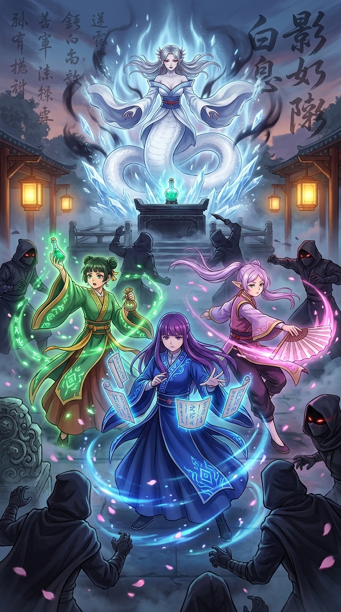

# Shadows of the White Lady

An epic 3D Wuxia fantasy action-adventure game built with **Three.js**, **React 19**, **TypeScript**, **Tailwind CSS**, and **Express**. Step into a lantern-lit, mist-shrouded imperial courtyard where three rune-infused heroes stand united against Shadow Assassins and **The White Lady** to protect the forbidden **Elixir of Immunity (Qi Yang)**.

<p align="center">
  
</p>

---

## Lore & Worldbuilding

### Elixir of Immunity (Qi Yang)
Of unknown ancient origin, whispered to have been forged by **Axia, the God of Medicine**, the Qi Yang Elixir heals mortals from within, purges every malady, and bestows immortality alongside eternal youth. Even divine beings covet its radiance to ascend beyond their limits—yet its power carries a **fatal flaw**: consumed or channeled beyond measure, Qi Yang's life-giving essence inverts into a lethal, corrosive poison.

### The White Lady · Cursed Divine Serpent
Once a revered **Divine Serpent**, she was cast down and cursed by the **King of Gods**. In her consuming wrath, the curse mutated into far greater frost-serpent power. Now she hovers above the imperial altar amidst jagged ice crystals, commanding Shadow Assassins to seize Axia's Elixir and break heaven's decree.

---

## The Squad & Combat System

Switch seamlessly between all three heroes (`[1]`–`[3]`). Each hero has independent `[Q]` and `[E]` skill cooldowns, encouraging rapid squad-switching combos, **Fight IQ** buildup, and **Squad Retaliation** bursts when striking poisoned or exposed foes.

| Key | Hero | Title & Role | Passive Specialty | Signature Arts |
| :--- | :--- | :--- | :--- | :--- |
| `[1]` | **Maomi** | Poison-Tasting Herbalist | **Natural Tolerance**: Resists **50%** of Frost Miasma and poison damage; converts cleansed toxins into toxic retaliation. | `[Q]` **Venom-Fang Stun** — Emerald vial AoE that stuns (`2.4s`) and poisons foes.<br>`[E]` **Tolerance Purge** — Restores `+38` Squad HP, cleanses Miasma, and erupts purified toxins into a poison surge. |
| `[2]` | **Jinka** | Sharp Court Strategist | **Perfect Planning**: Intuition marks expose enemy weak points (`+35%` Fight IQ damage) and accelerate squad cooldowns. | `[Q]` **Tactical Insight** — Fires 3 ley-line scrolls that expose targets.<br>`[E]` **Grand Plan Seal** — Accelerates squad cooldowns (`-35%`), stuns, exposes, and breaks nearby armor. |
| `[3]` | **Laulan** | Martial Arts Tactician | **Pinpoint Acupressure**: Acupuncturist precision interrupts enemy attack telegraphs and fuels Squad Retaliation. | `[Q]` **Acupoint Piercer** — Pinpoint `46 DMG` meridian strike that interrupts `windup` telegraphs and shatters armor.<br>`[E]` **Meridian Counter** — Dashes forward, grants `+35` Lotus Ward barrier, strikes foes, and builds `+2` Fight IQ. |

### Teamwork Mechanics
- **Fight IQ & Squad Retaliation**: Chaining attacks onto **poisoned** (Maomi) or **exposed** (Jinka) targets builds **Fight IQ** stacks (up to `5/5`) and triggers high-impact **Squad Retaliation** bonus strikes.
- **Tri-Qi Resonance (`[R]`)**: At `100%` Resonance, all three heroes unleash pure medicinal light (`88` AoE damage, armor break, `+25` HP heal, and full Miasma cleanse) to shatter The White Lady's Frost Ward.
- **Frost Ward & Escorts**: While Shadow Assassins guard The White Lady, her Frost Ward reduces incoming damage by `50%` until her escorts are cleared or `[R]` breaks her guard.

---

## Controls

| Input | Action |
| :--- | :--- |
| `W A S D` / `Arrow Keys` | Move active hero (companions follow in triangular Wuxia formation) |
| `1` / `2` / `3` | Switch active hero (**Maomi** / **Jinka** / **Laulan**) |
| `Space` / `J` | Basic Strike |
| `Q` | Primary Martial / Herbal / Tactical Art |
| `E` | Secondary Purge / Planning / Counter Art |
| `R` | **Tri-Qi Resonance** Ultimate (at `100%` Resonance) |
| `M` | Mute / Unmute procedural Guqin & combat audio |
| `P` / `Esc` | Pause / Resume |

---

## Features & Architecture

- **3D Courtyard & Procedural PBR Assets (`src/game/models.ts`, `src/game/WuxiaScene.ts`)**:
  - Articulated anime-human hero rigs with custom procedural `CanvasTexture` faces, rune-embroidered Hanfu robes, crossed lapels, floating strategy scrolls, glowing emerald Qi Yang vial, unfolded combat fan, and acupuncture needles.
  - Mist-shrouded imperial courtyard with cherry blossom trees, warm courtyard lanterns, drifting petals, pooled instanced magic sparks, and an adaptive software-WebGL render loop (`RoomEnvironment` IBL + `afterDraw` synchronization).
- **Procedural Pentatonic Audio (`src/game/audio.ts`)**: Zero-dependency Web Audio API Guqin ambience and combat SFX synthesizer.
- **Imperial Atelier (`src/components/ImperialAtelierModal.tsx`, `server.ts`)**: Optional server-side `@google/genai` studio modal supporting:
  - **Music (`POST /api/music`)**: `lyria-3-clip-preview` / `lyria-3-pro-preview` soundtrack generation
  - **Create & Edit Art (`POST /api/image/create-edit`)**: `gemini-nano-banana-2.1` concept art generation & editing
  - **HQ Poster (`POST /api/image/hq`)**: `gemini-3-pro-image-preview` (`1K` / `2K` / `4K`)
  - **Voice TTS (`POST /api/tts`)**: `gemini-3.8-flash-tts` single-narrator and dual-speaker hero banter

---

## Getting Started

### Prerequisites
- **Node.js** `20+` (recommended `22+`)
- **npm**

### Installation

```bash
npm install
```

### Environment Variables (Optional for Imperial Atelier)
The core 3D game and procedural audio run completely standalone with no API key required. To enable the **Imperial Atelier** generative media endpoints, copy `.env.example` to `.env` and configure your Gemini API key:

```bash
cp .env.example .env
```

```env
GEMINI_API_KEY="your_gemini_api_key"
APP_URL="http://localhost:3000"
```

### Running Locally

```bash
# Development server (Express + Vite middleware on http://localhost:3000)
npm run dev
```

Open `http://localhost:3000` in your browser (or `http://localhost:3000/?autostart=1` to jump directly into combat).

### Build, Lint & Tests

```bash
# Run pure combat/lore/AI unit tests
npx tsx --test src/game/rules.test.ts

# Type-check TypeScript
npm run lint

# Build production client bundle
npm run build

# Start production server
NODE_ENV=production npm start
```

---

## Project Structure

```text
├── public/assets/aistudio/          # Concept art poster & reference assets
├── server.ts                        # Express server, Vite middleware & @google/genai Atelier APIs
├── src/
│   ├── App.tsx                      # Root application state & modal orchestration
│   ├── components/
│   │   ├── TitleScreen.tsx          # Live 3D title overlay & quick actions
│   │   ├── GameHUD.tsx              # Squad Vitality, Fight IQ, Boss bar & single-row ability dock
│   │   ├── Modals.tsx               # Pause, Victory/Defeat & Squad Codex (Lore & Hero Dossiers)
│   │   └── ImperialAtelierModal.tsx # Music, Image Create/Edit, HQ Poster & Voice TTS studio
│   └── game/
│       ├── types.ts                 # Shared TypeScript interfaces for heroes & combat snapshots
│       ├── rules.ts                 # Lore chronicles, hero stats, Fight IQ retaliation & enemy steering
│       ├── rules.test.ts            # Unit tests (node:test) for pure game rules
│       ├── models.ts                # Procedural 3D human hero, assassin, White Lady & courtyard builders
│       ├── audio.ts                 # Web Audio API pentatonic Guqin & combat SFX synthesizer
│       └── WuxiaScene.ts            # Three.js engine, combat loop, hitstop & particle pools
├── package.json
├── tsconfig.json
└── vite.config.ts
```
##Credits
Build using Google Gemini and Google AI Studio 🌿
